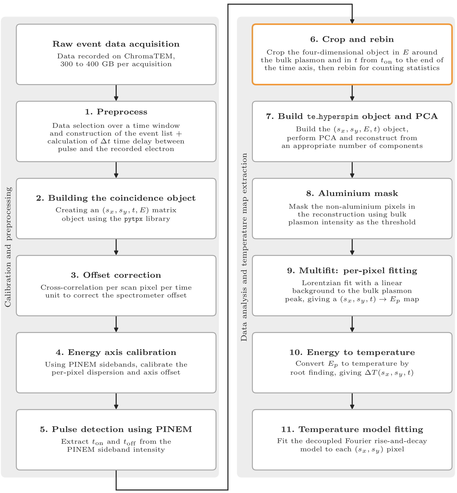

# Temperature mapping of aluminium nanobridges with time-resolved EELS

An 11-step Python pipeline from my Master's thesis. It measures how laser-heated aluminium nanobridges
heat up and cool down, on nanosecond time scales, using time-resolved electron energy-loss
spectroscopy (TR-EELS) with an event-based Timepix3 detector.

The pipeline turns raw electron events (300-400 GB per acquisition) into a temperature-change map
ΔT(x, y, t). It then fits a rise-and-decay model to every pixel.

The full thesis, *Heat transport in confined nanostructures*, is included in this repository as
[`Masters_thesis_Anupam_Chauhan_EMMNANO.pdf`](Masters_thesis_Anupam_Chauhan_EMMNANO.pdf). It covers the physics, the experiment and the results behind this code.

## Pipeline



A vector version is in [`pipeline-flowchart.pdf`](pipeline-flowchart.pdf).

| Step | Name | Stage | File |
|---|---|---|---|
| 1 | Preprocess | Calibration and preprocessing | `raw_to_temperature.ipynb` |
| 2 | Build the coincidence object | Calibration and preprocessing | `raw_to_temperature.ipynb` |
| 3 | Offset correction | Calibration and preprocessing | `raw_to_temperature.ipynb` |
| 4 | Energy axis calibration | Calibration and preprocessing | `raw_to_temperature.ipynb` |
| 5 | Pulse detection using PINEM | Calibration and preprocessing | `raw_to_temperature.ipynb` |
| 6 | Crop and rebin | Temperature map extraction | `raw_to_temperature.ipynb` |
| 7 | Build te_hyperspim object and PCA | Temperature map extraction | `raw_to_temperature.ipynb` |
| 8 | Aluminium mask | Temperature map extraction | `raw_to_temperature.ipynb` |
| 9 | Multifit: per-pixel fitting | Temperature map extraction | `raw_to_temperature.ipynb` |
| 10 | Energy to temperature | Temperature map extraction | `raw_to_temperature.ipynb` |
| 11 | Temperature model fitting | Temperature map extraction | `temperature_fitting.ipynb` |

### What each step does

1. **Preprocess.** Selects the events in the acquisition time window, builds the event list, and
   computes the delay Δt between each laser pulse and the detected electron.
2. **Build the coincidence object.** Loads the events into a `pytpx.CoincidenceEvents` object with
   axes (sx, sy, t, E).
3. **Offset correction.** A detector offset shifts the spectra across the scan. Each pixel's spectrum
   is cross-correlated with a reference spectrum from the scan centre, and the offset is subtracted
   from every event.
4. **Energy axis calibration.** The laser creates PINEM sidebands at ±ħω (550 nm, about 2.25 eV).
   Their separation sets the dispersion, and their midpoint places the zero-loss peak at 0 eV.
5. **Pulse detection using PINEM.** The sideband exists only while the laser is on, so its intensity
   over time gives the laser turn-on and turn-off times, `t_on` and `t_off`.
6. **Crop and rebin.** Keeps the energy range around the aluminium bulk plasmon (about 15 eV) and a
   time window that starts before `t_on`. Then rebins for counting statistics.
7. **PCA.** Builds the 4D (sx, sy, t, E) data set and denoises it by PCA reconstruction.
8. **Aluminium mask.** Drops pixels without a bulk plasmon signal (outside the aluminium).
9. **Multifit.** Fits a Lorentzian and a linear background to the plasmon in every pixel and time
   frame, which gives the plasmon energy map E_p(sx, sy, t).
10. **Energy to temperature.** Heating expands the metal and lowers its free-electron density, so
    the plasmon red-shifts. Inverting this relation gives ΔT(sx, sy, t).
11. **Temperature model fitting.** Fits a rise-and-decay model to the ΔT transient of every pixel.
    The fitted parameters (amplitudes, rise and decay times, peak temperature)
    are shown as spatial maps and can be exported per pixel.

## Physics - brief

The bulk plasmon energy depends on the free-electron density, E_p ∝ √n. When the aluminium heats up,
thermal expansion lowers n, so the plasmon red-shifts. With a temperature-dependent expansion
coefficient α(T) = α₀ + α₁ΔT + α₂ΔT², the relative shift is

    ΔE_p / E_p(T0) = (3/2) · (α₀ΔT + α₁ΔT²/2 + α₂ΔT³/3)

where ΔE_p = E_p(T0) - E_p(T). This cubic is solved for ΔT in every pixel and time frame. The
reference E_p(T0) comes from the frames recorded before the laser pulse.

After the pulse, heat flows along the bridge into the pads at both ends, which act as heat sinks.
The ΔT transient of each pixel is fitted with a rise-and-decay model with separate amplitudes
(Δt = t - t_on):

    ΔT(t) = A_1 · exp(-Δt / τ_decay) - A_2 · exp(-Δt / τ_rise) + C

## Repository contents

| File | Description |
|---|---|
| `raw_to_temperature.ipynb` | Steps 1-10: raw events to the temperature map |
| `temperature_fitting.ipynb` | Step 11: temperature map to per-pixel transient fits |
| `README.md` | This file |
| `DESIGN_CHOICES.md` | Reasons behind the parameter and method choices |
| `environment.yml` | Conda environment with the required packages |
| `pipeline-flowchart.png`, `pipeline-flowchart.pdf` | Pipeline figure |
| `Masters_thesis_Anupam_Chauhan_EMMNANO.pdf` | Master's thesis (PDF) |

## Installation

The environment is defined in [`environment.yml`](environment.yml). It needs
[conda](https://docs.conda.io/) (Miniconda, Miniforge or Anaconda).

```bash
conda env create -f environment.yml
```

```bash
conda activate tr-eels-temperature
```

### Installing pytpx

`pytpx` is a private package of the STEM group. Ask the maintainer (FCastioni) for collaborator
access to [FCastioni/pytpx](https://github.com/FCastioni/pytpx), then install it with pip (needs
[Git](https://git-scm.com)) into the activated environment:

```bash
pip install "pytpx[viz] @ git+https://github.com/FCastioni/pytpx.git"
```

To update it later:

```bash
pip install --upgrade "pytpx[viz] @ git+https://github.com/FCastioni/pytpx.git"
```

The `[viz]` extra installs HyperSpy support, which this pipeline needs.

### Starting the notebook

Start Jupyter, then open `raw_to_temperature.ipynb` (steps 1-10) and afterwards
`temperature_fitting.ipynb` (step 11):

```bash
jupyter lab
```

### What the environment contains

| Package | Used for |
|---|---|
| Python 3.13 | The thesis analysis ran on Python 3.13.1 |
| `pytpx` (private, see above) | Timepix3 event data and the `CoincidenceEvents` object |
| `hyperspy` (>= 2.0) | Signals, model fitting, multifit, PCA, `.hspy` files |
| `numpy`, `scipy` | Arrays, FFT cross-correlation, root finding |
| `scikit-learn` | PCA backend (`algorithm="sklearn_pca"`) |
| `matplotlib`, `ipympl` | Plots; interactive plots with `%matplotlib widget` |
| `pandas`, `tqdm` | Temperature model fitting (step 11) |
| `jupyterlab` | Running the notebooks |
| `ffmpeg` | Optional GIF export of the ΔT movie |

Package versions were not recorded during the thesis work, so `environment.yml` gives only minimum
versions.

## Running the notebooks

### raw_to_temperature.ipynb (steps 1-10)

1. Activate the environment (see Installation) and set `meta_data_path` (raw acquisition) and `output_data_path` (preprocessed events).
2. Run the preprocessing cell once per acquisition, then comment it out again.
3. Adjust the per-dataset parameters below, then run the cells in order. Check the plots after
   steps 3, 4 and 5.
4. The per-pixel fit in step 9 is the slow part: about 1.5 h for a 32 x 32 x 1408 data set.

### temperature_fitting.ipynb (step 11)

1. Set the path to the temperature map saved by `raw_to_temperature.ipynb`.
2. In the Configuration cell, set the fit mode (`fit_rise`, `fit_model`), the laser turn-on time
   `t_on_ns` and the initial guesses.
3. Run the cells in order.
4. Use the histogram to choose display limits, then export the masked maps and the selected pixels.
   The interactive viewer shows the data and fit of any pixel you click.

### Per-dataset parameters

These are the values used for scan 02.

| Parameter | Where | Value (scan 02) |
|---|---|---|
| PINEM crop windows (E, t) | Step 4 | +1.9 to +2.5 eV and -2.6 to -1.8 eV, 2540-2590 ns |
| PINEM fit guesses (centre, bounds) | Step 4 | -2.27 eV [-2.4, -2.1], +2.22 eV [2.0, 2.4] |
| `initial_time_slice` | Step 5 | [2530.0, 2590.0] ns |
| Bulk plasmon guess, window | Pre-fit | 15.0 eV, ±2.0 eV |
| Time and energy crop | Step 6 | from 0.8 · t_on, 11264 channels; from 12 eV, 256 channels |
| Rebin factors (t, sx, sy, E) | Step 6 | 8, 8, 8, 2 |
| PCA components | Step 7 | 10 |
| Mask threshold | Step 8 | 0.25 of the maximum |
| Reference frames | Step 10 | first 90 frames |
| Fit mode | Step 11 | `fit_rise = True`, `fit_model = 2` (decoupled amplitudes) |
| Laser turn-on time `t_on_ns` | Step 11 | 2530.0 ns |
| Initial guesses | Step 11 | τ_rise = 15 ns, τ_decay = 300 ns |
| Display limits (`plot_config`) | Step 11 | per parameter, see the notebook |

### Outputs

| File | Content |
|---|---|
| `High res - fit model.hspy` | Fitted HyperSpy model from step 9 |
| `High - res Hyperspim - centres.hspy` | Plasmon energy map E_p(sx, sy, t) |
| `High - res Hyperspim - Temperatures.hspy` | Temperature map ΔT(sx, sy, t), the input of step 11 |
| `parameter_maps/*.pdf`, `*.png` | Masked parameter maps from step 11 |
| `experimental_fit_results.csv` | Fitted parameters of selected pixels |
| `model1_fit_results.pkl`, `model1_*.npy` | Saved fit results, data and time axis, to reload without re-fitting |

## Design choices

The reasons behind the main parameter and method choices (D1-D14) are in
[`DESIGN_CHOICES.md`](DESIGN_CHOICES.md).

## Thesis

A. Chauhan, *Heat transport in confined nanostructures*, Master's thesis, Erasmus Mundus Master of
Science in Nanoscience and Nanotechnology (Quantum and Nanoscale Engineering), KU Leuven and
Université Grenoble Alpes, academic year 2025-2026. Supervisor: Dr. Florian Castioni.
PDF: [`Masters_thesis_Anupam_Chauhan_EMMNANO.pdf`](Masters_thesis_Anupam_Chauhan_EMMNANO.pdf)
